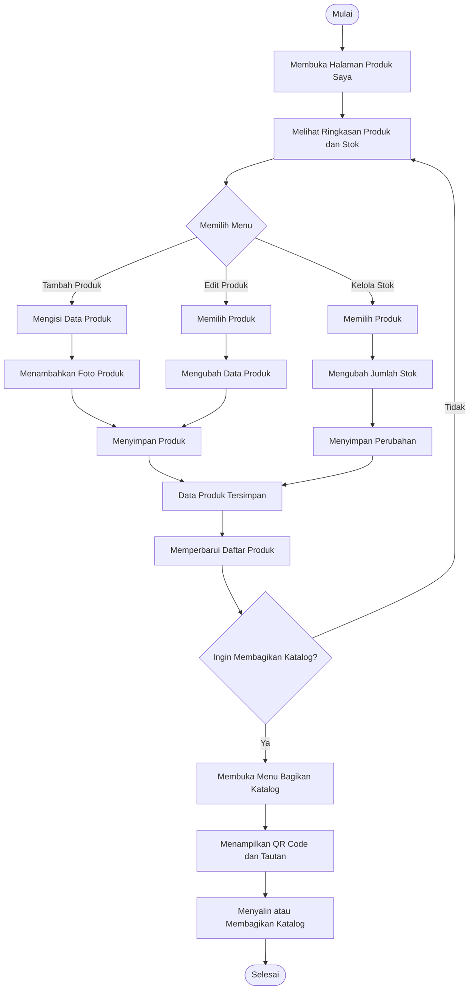
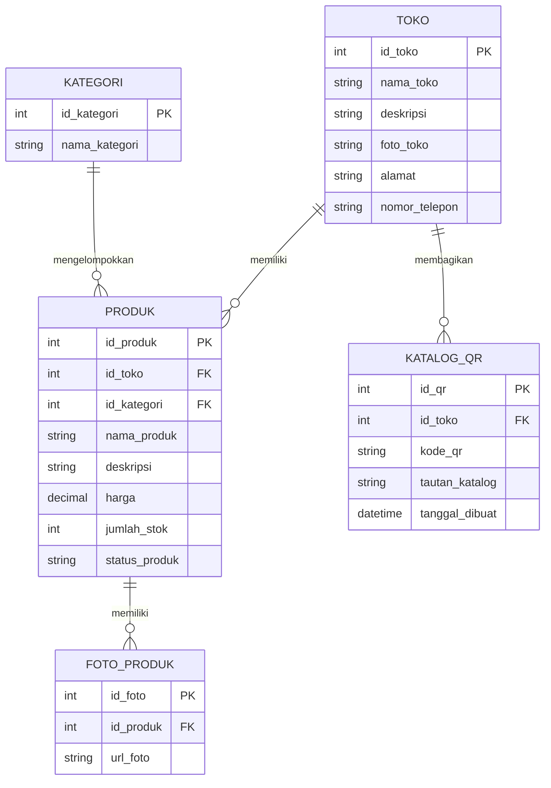

# SCRIPT PITCH DECK 5 BABAK – [PCB]

**Nama Platform:** Katalog Online Ida Leman Collection  
**Target Durasi:** ±7 Menit  
**Target UMKM:** Ida Leman Collection  
**Jenis Usaha:** Perlengkapan Rumah Tangga  
**Produk:** Panci, wajan, piring, dan peralatan dapur lainnya.

---

## BABAK 1 – THE HOOK & THE PROBLEM (±1,5 Menit)

**Pembicara:** fariz

**Naskah Lisan:**

Pernahkah kalian ingin membeli peralatan rumah tangga, tetapi harus bertanya satu per satu kepada penjual mengenai foto produk, harga, dan ketersediaan barang?

Hal seperti ini juga menjadi salah satu kendala dalam kegiatan jual beli di Ida Leman Collection.

Berdasarkan hasil wawancara dengan pemilik usaha, pelanggan biasanya menghubungi penjual melalui WhatsApp untuk menanyakan produk dan harga.

Namun, pemilik harus mengirimkan foto produk satu per satu melalui chat. Hal ini membutuhkan waktu, terutama ketika banyak pelanggan bertanya secara bersamaan.

Selain itu, pelanggan terkadang kesulitan mengetahui apakah barang masih tersedia atau sudah habis. Akibatnya, pelanggan harus bertanya kembali atau bahkan memeriksa barang secara langsung ke toko.

Narasumber juga menjelaskan bahwa kepercayaan pelanggan menjadi hal yang sangat penting dalam jual beli online. Pelanggan ingin mendapatkan barang yang sesuai dengan foto dan memiliki kualitas yang baik.

Dari permasalahan tersebut, kami melihat bahwa Ida Leman Collection membutuhkan cara yang lebih praktis untuk menampilkan produk kepada pelanggan.

Untuk menjawab permasalahan tersebut, selanjutnya rekan saya akan menjelaskan solusi yang kami tawarkan.

---

## BABAK 2 – THE SOLUTION (±1 Menit)

**Pembicara:** Anggota 2

**Naskah Lisan:**

Solusi yang kami tawarkan adalah membuat sebuah platform Katalog Online Ida Leman Collection.

Platform ini dirancang untuk membantu pemilik usaha menampilkan produk perlengkapan rumah tangga secara lebih teratur dan mudah diakses pelanggan.

Melalui katalog online, pelanggan dapat melihat foto produk, nama produk, harga, serta informasi ketersediaan stok tanpa harus bertanya satu per satu melalui WhatsApp.

Kami juga menyediakan tombol pemesanan WhatsApp sehingga pelanggan tetap bisa menghubungi pemilik secara langsung ketika ingin membeli produk.

Dengan adanya katalog ini, pemilik tidak perlu terus-menerus mengirimkan foto produk secara manual kepada setiap pelanggan.

**Value Proposition Statement:**

"Katalog Online Ida Leman Collection membantu pemilik usaha memasarkan produk perlengkapan rumah tangga dengan menampilkan foto, harga, dan informasi stok dalam satu tempat, sehingga pelanggan lebih mudah menemukan produk dan melakukan pemesanan melalui WhatsApp."

Selanjutnya, rekan saya akan memperlihatkan gambaran desain dan cara kerja platform yang kami buat.

---

## BABAK 3 – THE PROOF / DEMO ARTEFAK (±2,5 Menit)

**Pembicara:** Anggota 2 dan 3

**Naskah Lisan:**

Untuk membuktikan bahwa solusi kami dapat menjawab permasalahan tersebut, kami telah menyiapkan beberapa rancangan, yaitu Wireframe, Flowchart, dan ERD.

**Pertama, Wireframe dan UX.**

Pada rancangan tampilan katalog online, pelanggan akan melihat daftar produk perlengkapan rumah tangga seperti panci, wajan, dan piring.

Setiap produk memiliki foto, nama, harga, dan keterangan stok.

Kami juga menyediakan tombol WhatsApp yang mudah ditemukan sehingga pelanggan bisa langsung menghubungi penjual ketika ingin memesan.

Jika stok produk habis, tampilannya akan memberikan tanda bahwa produk tersebut sedang tidak tersedia. Dengan begitu, pelanggan tidak salah memahami ketersediaan barang.

**Kedua, Flowchart.**

Pada Flowchart, kami menggambarkan alur penggunaan platform.

Pertama, pelanggan membuka halaman katalog online. Kemudian pelanggan memilih produk yang diinginkan dan melihat informasi harga serta stok.

Jika produk tersedia, pelanggan dapat menekan tombol WhatsApp untuk melanjutkan pemesanan kepada pemilik toko.

Pemilik kemudian mengonfirmasi pesanan dan ketersediaan barang.

Jika produk tidak tersedia, pelanggan dapat memilih produk lainnya.

**Ketiga, ERD atau struktur database.**

ERD digunakan untuk menggambarkan hubungan antara data produk, kategori, pemilik usaha, dan pesanan.

Dengan struktur data tersebut, informasi produk dapat dikelola dengan lebih teratur.

Data nama produk, harga, stok, dan pesanan dapat disimpan sehingga pemilik lebih mudah mengelola informasi barang.

Melalui ketiga rancangan ini, kami berharap platform yang dikembangkan benar-benar sesuai dengan kebutuhan pemilik usaha dan pelanggan.

---

## BABAK 4 – THE IMPACT & VALUE (±1 Menit)

**Pembicara:** Anggota 3

**Naskah Lisan:**

Sekarang mari kita bayangkan perbedaan sebelum dan sesudah menggunakan katalog online.

Sebelum menggunakan katalog online, pelanggan harus menghubungi pemilik melalui WhatsApp untuk menanyakan foto, harga, dan ketersediaan produk.

Pemilik juga harus mengirimkan foto produk satu per satu sehingga membutuhkan waktu dan tenaga.

Setelah menggunakan katalog online, pelanggan dapat melihat informasi produk dalam satu halaman.

Pelanggan menjadi lebih mudah mengetahui harga dan stok barang sebelum menghubungi penjual.

Sementara itu, pemilik dapat mengurangi kegiatan mengirimkan foto produk secara berulang dan lebih fokus melayani pesanan pelanggan.

Dengan demikian, katalog online diharapkan dapat membuat kegiatan jual beli menjadi lebih praktis, teratur, dan meningkatkan kepercayaan pelanggan.

---

## BABAK 5 – ROADMAP & CALL TO ACTION (±1 Menit)

**Pembicara:** Anggota 4

**Naskah Lisan:**

Untuk pengembangan selanjutnya, kami telah menyiapkan beberapa rencana fitur.

Pada tahap awal, kami akan berfokus pada fitur utama atau Must-Have, yaitu:

1. Menampilkan katalog produk.
2. Menampilkan foto dan harga produk.
3. Menampilkan informasi ketersediaan stok.
4. Menyediakan tombol pemesanan melalui WhatsApp.
5. Menyediakan pengelolaan data produk oleh pemilik.

Setelah fitur utama berjalan dengan baik, kami berencana mengembangkan fitur tambahan atau Could-Have, seperti pencarian produk, filter kategori, dan riwayat pesanan.

Kami ingin memastikan bahwa platform ini mudah digunakan, baik oleh pemilik usaha maupun pelanggan yang belum terbiasa berbelanja secara online.

Harapan kami, Katalog Online Ida Leman Collection dapat membantu usaha menjadi lebih mudah dikenal dan memberikan pengalaman belanja yang lebih nyaman bagi pelanggan.

**Sebagai penutup, kami percaya bahwa usaha kecil juga memiliki kesempatan untuk berkembang dengan memanfaatkan teknologi sederhana yang sesuai dengan kebutuhan mereka.**

thanks for your all attentions 

# WIREFRAME KATALOG APLIKASI
[ini link wireframenya](https://www.figma.com/design/bNUu4FjZ4p5limjOiRrCOh/Untitled?node-id=0-1&t=XyBcg9B2FzgGGLvU-1)

# FLOWCHARTNYA

#### A. Flowchart Pembeli

#### B. Flowchart Pedagang

# ERD KATALOG

#### B. Penjelasan Entitas

| Entitas | Fungsi |
|---|---|
| TOKO | Menyimpan informasi identitas toko UMKM. |
| KATEGORI | Menyimpan kategori produk seperti panci, wajan, piring, dan gelas. |
| PRODUK | Menyimpan nama, harga, deskripsi, jumlah stok, dan status produk. |
| FOTO_PRODUK | Menyimpan foto produk yang dapat ditampilkan pada katalog dan detail produk. |
| KATALOG_QR | Menyimpan informasi QR Code dan tautan untuk membagikan katalog toko. |

#### C. Penjelasan Relasi

1. **TOKO - PRODUK (1:N)**

   Satu toko dapat memiliki banyak produk, tetapi satu produk hanya dimiliki oleh satu toko.

2. **KATEGORI - PRODUK (1:N)**

   Satu kategori dapat memiliki banyak produk, tetapi satu produk hanya memiliki satu kategori.

3. **PRODUK - FOTO_PRODUK (1:N)**

   Satu produk dapat memiliki beberapa foto, tetapi satu foto hanya dimiliki oleh satu produk.

4. **TOKO - KATALOG_QR (1:N)**

   Satu toko dapat memiliki beberapa data QR Code atau tautan katalog.

---

### 3. KETERANGAN TAMBAHAN

**Aturan status produk:**

- Jika `jumlah_stok > 0`, maka status produk adalah `Tersedia`.
- Jika `jumlah_stok = 0`, maka status produk adalah `Habis`.

**Primary Key (PK):**

Merupakan identitas unik untuk setiap data dalam tabel.

**Foreign Key (FK):**

Merupakan kolom yang menghubungkan satu tabel dengan tabel lainnya.

**Catatan:**

ERD ini disusun berdasarkan fitur yang terlihat pada wireframe. Fitur login, pembayaran, keranjang belanja, dan riwayat transaksi belum dimasukkan karena belum terlihat pada rancangan halaman aplikasi.

# BACKLOG KATALOG

# RENCANA FITUR BACKLOG
## Aplikasi Katalog Produk UMKM – Ida Leman Collection

### 1. Tujuan Backlog

Rencana fitur backlog dibuat untuk menentukan fitur apa saja yang akan dikembangkan dalam aplikasi katalog produk UMKM. Fitur disusun berdasarkan kebutuhan pedagang dan pembeli agar proses pembuatan aplikasi lebih terarah.

### 2. Daftar Prioritas Fitur

| No. | Nama Fitur | Prioritas | Alasan |
|---|---|---|---|
| 1 | Katalog Produk | Wajib Ada | Pembeli dapat melihat daftar produk yang dijual. |
| 2 | Tambah dan Edit Produk | Wajib Ada | Pedagang dapat menambahkan dan memperbarui informasi produk. |
| 3 | Manajemen Stok | Wajib Ada | Pedagang dapat mengatur jumlah stok barang. |
| 4 | Pencarian Produk | Penting | Memudahkan pembeli menemukan produk yang dicari. |
| 5 | Kategori Produk | Penting | Memudahkan pembeli mencari produk berdasarkan jenisnya. |
| 6 | Pemesanan WhatsApp | Penting | Memudahkan pembeli melakukan pemesanan melalui WhatsApp. |
| 7 | Status Ketersediaan | Penting | Pembeli dapat mengetahui produk yang tersedia atau habis. |
| 8 | QR Code Katalog | Pelengkap | Memudahkan pedagang membagikan katalog kepada pembeli. |
| 9 | Banyak Foto Produk | Pelengkap | Memberikan gambaran produk yang lebih jelas kepada pembeli. |
| 10 | Laporan Penjualan | Nanti Dulu | Belum menjadi kebutuhan utama pada tahap awal pengembangan. |

### 3. Rencana Pengerjaan

**Tahap 1 – Fitur Utama**
- Membuat halaman katalog produk.
- Membuat fitur tambah dan edit produk.
- Membuat fitur manajemen stok.

**Tahap 2 – Fitur Pendukung**
- Membuat pencarian produk.
- Membuat kategori produk.
- Membuat pemesanan melalui WhatsApp.
- Menampilkan status ketersediaan produk.

**Tahap 3 – Fitur Pelengkap**
- Membuat QR Code katalog.
- Menambahkan beberapa foto produk.

**Tahap 4 – Pengembangan Selanjutnya**
- Membuat laporan penjualan.

### 4. Kesimpulan

Pengembangan aplikasi akan dimulai dari fitur utama yang paling dibutuhkan oleh pedagang dan pembeli. Setelah fitur utama selesai, pengembangan dilanjutkan ke fitur pendukung dan pelengkap. Dengan adanya backlog, proses pengerjaan aplikasi menjadi lebih terarah dan sesuai kebutuhan UMKM.

