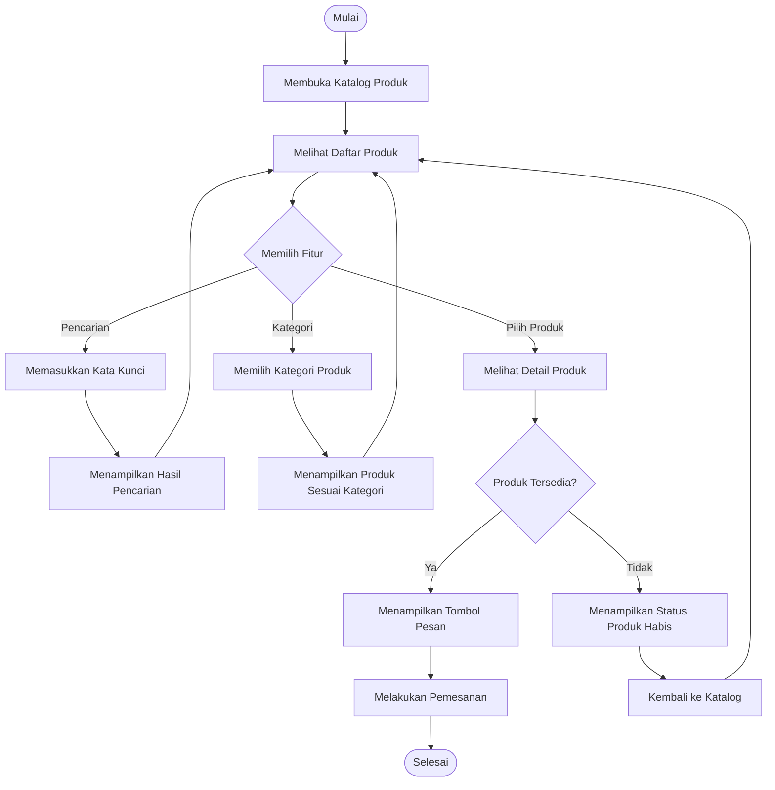
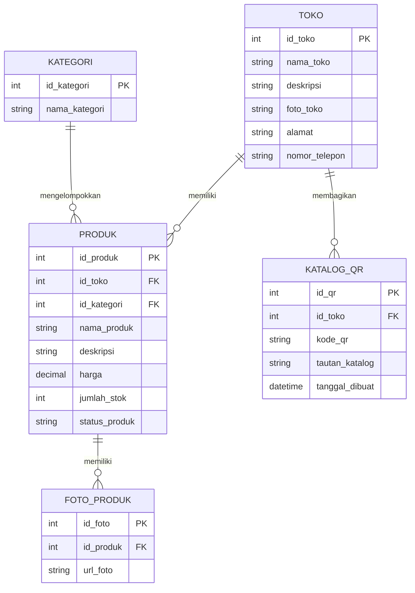

# WIREFRAME KATALOG APLIKASI
[ini link wireframenya](https://www.figma.com/design/bNUu4FjZ4p5limjOiRrCOh/Untitled?node-id=0-1&t=XyBcg9B2FzgGGLvU-1)

# FLOWCHARTNYA

#### A. Flowchart Pembeli

#### B. Flowchart Pedagang

# ERD KATALOG

#### B. Penjelasan Entitas

| Entitas | Fungsi |
|---|---|
| TOKO | Menyimpan informasi identitas toko UMKM. |
| KATEGORI | Menyimpan kategori produk seperti panci, wajan, piring, dan gelas. |
| PRODUK | Menyimpan nama, harga, deskripsi, jumlah stok, dan status produk. |
| FOTO_PRODUK | Menyimpan foto produk yang dapat ditampilkan pada katalog dan detail produk. |
| KATALOG_QR | Menyimpan informasi QR Code dan tautan untuk membagikan katalog toko. |

#### C. Penjelasan Relasi

1. **TOKO - PRODUK (1:N)**

   Satu toko dapat memiliki banyak produk, tetapi satu produk hanya dimiliki oleh satu toko.

2. **KATEGORI - PRODUK (1:N)**

   Satu kategori dapat memiliki banyak produk, tetapi satu produk hanya memiliki satu kategori.

3. **PRODUK - FOTO_PRODUK (1:N)**

   Satu produk dapat memiliki beberapa foto, tetapi satu foto hanya dimiliki oleh satu produk.

4. **TOKO - KATALOG_QR (1:N)**

   Satu toko dapat memiliki beberapa data QR Code atau tautan katalog.

---

### 3. KETERANGAN TAMBAHAN

**Aturan status produk:**

- Jika `jumlah_stok > 0`, maka status produk adalah `Tersedia`.
- Jika `jumlah_stok = 0`, maka status produk adalah `Habis`.

**Primary Key (PK):**

Merupakan identitas unik untuk setiap data dalam tabel.

**Foreign Key (FK):**

Merupakan kolom yang menghubungkan satu tabel dengan tabel lainnya.

**Catatan:**

ERD ini disusun berdasarkan fitur yang terlihat pada wireframe. Fitur login, pembayaran, keranjang belanja, dan riwayat transaksi belum dimasukkan karena belum terlihat pada rancangan halaman aplikasi.

# BACKLOG KATALOG

# RENCANA FITUR BACKLOG
## Aplikasi Katalog Produk UMKM – Ida Leman Collection

### 1. Tujuan Backlog

Rencana fitur backlog dibuat untuk menentukan fitur apa saja yang akan dikembangkan dalam aplikasi katalog produk UMKM. Fitur disusun berdasarkan kebutuhan pedagang dan pembeli agar proses pembuatan aplikasi lebih terarah.

### 2. Daftar Prioritas Fitur

| No. | Nama Fitur | Prioritas | Alasan |
|---|---|---|---|
| 1 | Katalog Produk | Wajib Ada | Pembeli dapat melihat daftar produk yang dijual. |
| 2 | Tambah dan Edit Produk | Wajib Ada | Pedagang dapat menambahkan dan memperbarui informasi produk. |
| 3 | Manajemen Stok | Wajib Ada | Pedagang dapat mengatur jumlah stok barang. |
| 4 | Pencarian Produk | Penting | Memudahkan pembeli menemukan produk yang dicari. |
| 5 | Kategori Produk | Penting | Memudahkan pembeli mencari produk berdasarkan jenisnya. |
| 6 | Pemesanan WhatsApp | Penting | Memudahkan pembeli melakukan pemesanan melalui WhatsApp. |
| 7 | Status Ketersediaan | Penting | Pembeli dapat mengetahui produk yang tersedia atau habis. |
| 8 | QR Code Katalog | Pelengkap | Memudahkan pedagang membagikan katalog kepada pembeli. |
| 9 | Banyak Foto Produk | Pelengkap | Memberikan gambaran produk yang lebih jelas kepada pembeli. |
| 10 | Laporan Penjualan | Nanti Dulu | Belum menjadi kebutuhan utama pada tahap awal pengembangan. |

### 3. Rencana Pengerjaan

**Tahap 1 – Fitur Utama**
- Membuat halaman katalog produk.
- Membuat fitur tambah dan edit produk.
- Membuat fitur manajemen stok.

**Tahap 2 – Fitur Pendukung**
- Membuat pencarian produk.
- Membuat kategori produk.
- Membuat pemesanan melalui WhatsApp.
- Menampilkan status ketersediaan produk.

**Tahap 3 – Fitur Pelengkap**
- Membuat QR Code katalog.
- Menambahkan beberapa foto produk.

**Tahap 4 – Pengembangan Selanjutnya**
- Membuat laporan penjualan.

### 4. Kesimpulan

Pengembangan aplikasi akan dimulai dari fitur utama yang paling dibutuhkan oleh pedagang dan pembeli. Setelah fitur utama selesai, pengembangan dilanjutkan ke fitur pendukung dan pelengkap. Dengan adanya backlog, proses pengerjaan aplikasi menjadi lebih terarah dan sesuai kebutuhan UMKM.

